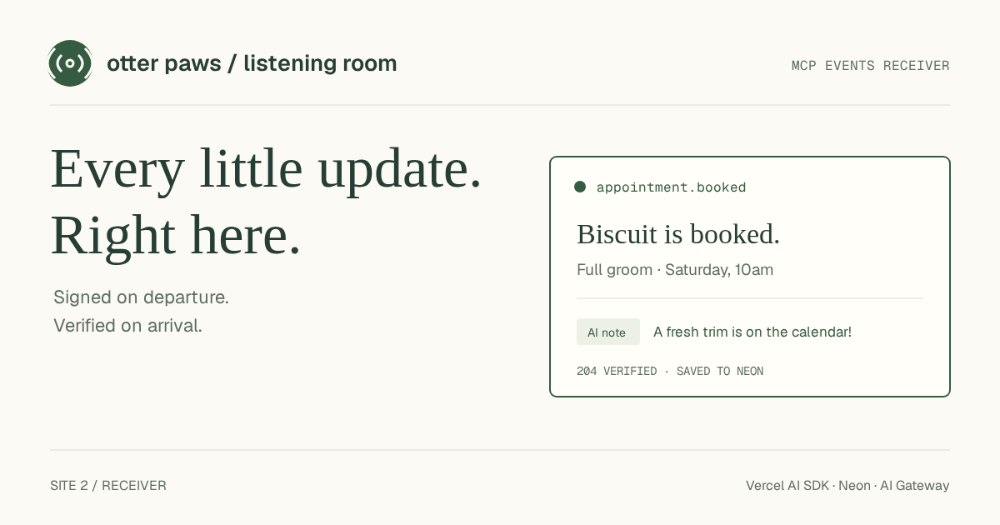
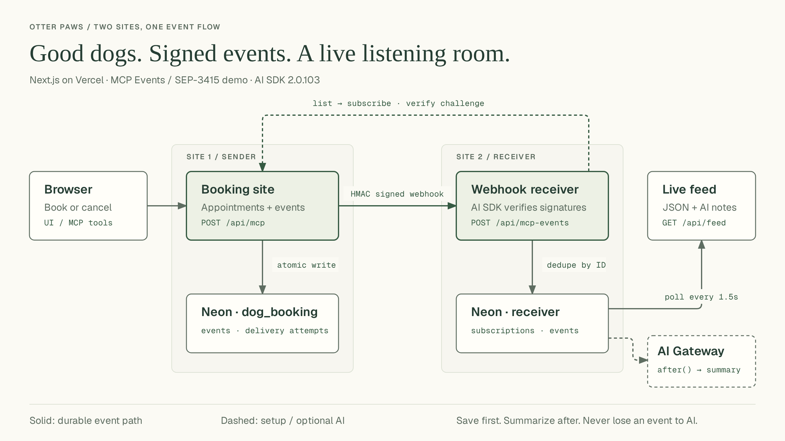

# Otter Paws · MCP Events receiver

The listening room is the receiver half of a two-site MCP Events / SEP-3415 demo: subscribe to the Otter Paws booking sender, verify signed appointment webhooks, and watch a durable live feed with expandable raw JSON and optional friendly AI summaries. Built with Next.js 16.4.6, Vercel AI SDK `ai`, `@ai-sdk/mcp@2.0.103`, and Neon Postgres, it saves events before attempting AI work and deduplicates by event ID.

**Tags:** `mcp` `mcp-events` `sep-3415` `vercel-ai-sdk` `nextjs` `neon` `webhooks` `demo`

**Live:** [Events receiver](https://mcp-events-receiver-two.vercel.app) · [Booking sender](https://mcp-events-dog-booking.vercel.app) · [Sender source](https://github.com/focusOtter/mcp-events-dog-booking/tree/devin/site1-booking)

> **Demo tip:** Receiver subscriptions last **24 hours**. Before a talk, click **Subscribe to events** (or **Refresh subscriptions** if already subscribed), then confirm **2/2 active** before booking on the sender.

## How it works



1. **Subscribe:** The Subscribe server action creates `createMCPClient` with HTTP transport to the sender's `/api/mcp` and a Postgres-backed `experimental_events` store. It lists the event catalog, then subscribes to `appointment.booked` and `appointment.cancelled`, using this site's `/api/mcp-events` callback URL.
2. **Verify challenge:** The sender posts a signed verification challenge before activating delivery. `experimental_createMCPEventWebhook` loads the SDK subscription record from Neon, verifies the signature and routing key, and echoes the challenge.
3. **Book:** A browser booking or MCP tool call at the sender atomically saves the appointment and event in Neon `dog_booking`; cancellation emits the corresponding cancelled event.
4. **Signed webhook:** The sender delivers `{eventId,name,timestamp,data,cursor}` with Standard Webhooks HMAC-SHA256 headers. The receiver's SDK handler validates the signature, timestamp and subscription, then persists the event to Neon `receiver`, deduped by `eventId`, before returning 204.
5. **Receiver feed + AI:** The home page polls `/api/feed` every 1.5 seconds, highlights arrivals and offers expandable JSON. After the durable write, `after()` uses `generateText` and AI Gateway for an optional one-line summary, authenticated by Vercel request-context OIDC in deployment or an API key locally. AI failure does not block persistence.

Diagram source: [HTML](docs/architecture.html) · [SVG](docs/architecture.svg). Social-card source: [HTML](docs/og.html). The diagram uses the approved Otter Paws cream-and-forest palette, Georgia headings and Geist / Geist Mono; the editable HTML/SVG loads the latter from Google Fonts. PNGs have no runtime font dependency.

## Compatibility notes

These are deliberate interoperability accommodations for **AI SDK MCP 2.0.103**, not a claim of full SEP-3415 support.

| AI SDK vs. SEP-3415 | How the booking server accommodates it |
| --- | --- |
| The SDK checks top-level `capabilities.events`; SEP-3415 uses `capabilities.extensions["io.modelcontextprotocol/events"]`. | Advertises both shapes so this SDK enables Events while extension-aware clients can discover the SEP capability. |
| The SDK requires `webhook-id == eventId`; Standard Webhooks message identity need not otherwise equal the event identity. | Uses the payload's `eventId` as `webhook-id` and as the ID in the signed string. Retries keep it, and this receiver deduplicates on it. |
| The SDK omits the SEP's `Mcp-Name` header on Events requests. | Does not require that header; dispatches named `events/*` JSON-RPC methods at `/api/mcp`. |
| The SDK exposes webhook delivery, not Events poll/stream transports. | Advertises webhook delivery only and implements subscribe/unsubscribe with signed callbacks, not poll/stream or historical replay. This site's 1.5-second feed polling is application HTTP, not MCP Events polling. |

The sender also supports modern `server/discover` and the legacy `initialize` exchange used by this SDK. The complete private SDK subscription, including callback routing data and secret, stays server-side in Postgres.

## Setup

Use Node 24 (`source ~/.nvm/nvm.sh && nvm use 24`). In gitignored `.env.local`, set:

```dotenv
DATABASE_URL=<Neon connection string for database receiver>
MCP_SERVER_URL=http://127.0.0.1:3000/api/mcp
APP_BASE_URL=http://127.0.0.1:3001
# Optional locally: AI_GATEWAY_API_KEY
```

```sh
npm ci
npm run db:setup
npm run dev -- --hostname 127.0.0.1 --port 3001
```

Run site 1 on port 3000, then open http://127.0.0.1:3001 and Subscribe. HTTP loopback callbacks work only in development. On Vercel, `APP_BASE_URL` overrides the default `https://${VERCEL_PROJECT_PRODUCTION_URL}`. Use a stable public HTTPS origin, not a protected preview URL. The webhook route must already be deployed before subscribing.

Neon project: `mcp-events-spike` (`silent-shape-25570154`), database `receiver`. Schema setup is idempotent and does not touch site 1's `dog_booking` database.

## Behavior

- The Subscribe server action creates an HTTP MCP client with a Postgres-backed `experimental_events` store, lists the catalog and subscribes to both events for 24 hours. Clicking again refreshes existing subscriptions with the same callback identity. Unsubscribe removes upstream and local subscriptions, retaining received history. A short database lease serializes button actions across instances.
- The private store persists the entire SDK subscription (including its generated secret) before the callback challenge. JSONB patch updates are atomic and scoped to `MCP_SERVER_URL`. No subscription records or secrets are sent to the browser: only ID, name, status and refresh deadline.
- `POST /api/mcp-events` uses `experimental_createMCPEventWebhook` for signature, timestamp, routing key, subscription and challenge verification. The event insert is awaited and `eventId` is a Postgres primary key. A database failure returns 503 for sender retries; duplicate events return 204 without duplicate summaries.
- After the write, Next.js `after()` attempts a one-line summary with `generateText` and `gateway('openai/gpt-4o-mini')`. It uses Vercel OIDC automatically in deployment or `AI_GATEWAY_API_KEY` locally. No credentials or AI failure means no summary, not a lost event. Owner names are not sent to the model.
- `GET /api/feed` is an uncached, read-only view of the newest 50 events and safe subscription metadata. The page polls every 1.5 seconds, highlights new entries and respects reduced-motion preferences. All displayed times are UTC.

## Checks

```sh
npm test
npx tsc --noEmit
npm run lint
npm run build
```

Vitest covers store get/getById/set/atomic update/delete, unknown records and database errors, insert deduplication, the actual webhook route with signed (204) and unsigned (401) requests, pending verification (200), invalid payloads (400), persistence failure (503), AI scheduling and failure isolation.

## Layout

- `src/app/receiver.tsx`, `page.tsx`, `globals.css`: live inbox and subscription controls.
- `src/app/actions.ts`, `src/lib/subscriptions.ts`: subscribe/refresh/unsubscribe via the AI SDK client.
- `src/lib/store.ts`: private Postgres MCPEventStore.
- `src/app/api/mcp-events/route.ts`, `src/lib/webhook.ts`: SDK-verified receiver.
- `src/lib/events.ts`, `summaries.ts`, `src/app/api/feed/route.ts`: event persistence, optional AI and safe feed.
- `scripts/setup-db.ts`: idempotent tables and indexes.

## Deployment and demo boundaries

Git-connected Vercel projects live in `focus-otters-projects`; the feature branch is `devin/receiver`. Production is initially deployed from the feature branch for testing; the Git production branch remains `main` for after merge. Vercel Authentication must be disabled on this demo so the sender can POST without a Vercel session.

This is intentionally a shared, anonymous demonstration, not a production multi-user inbox. Anyone with the URL can read fictional appointment data and operate the two configured subscriptions. Do not use real personal data. Before production use add authentication, tenant-scoped authorization, retention, rate limiting, encrypted secret management, a durable summary queue and automated lease renewal. AI work is best-effort after the response, not a durable job. Pending records from uncertain subscription failures can be retried with Subscribe or removed with Unsubscribe. Shared history is not cleared by unsubscribe.

Friction and deployment evidence: `/home/ubuntu/scratch/friction.md` and `/home/ubuntu/scratch/receiver-live-e2e.json` on the development machine. No credentials are committed.
